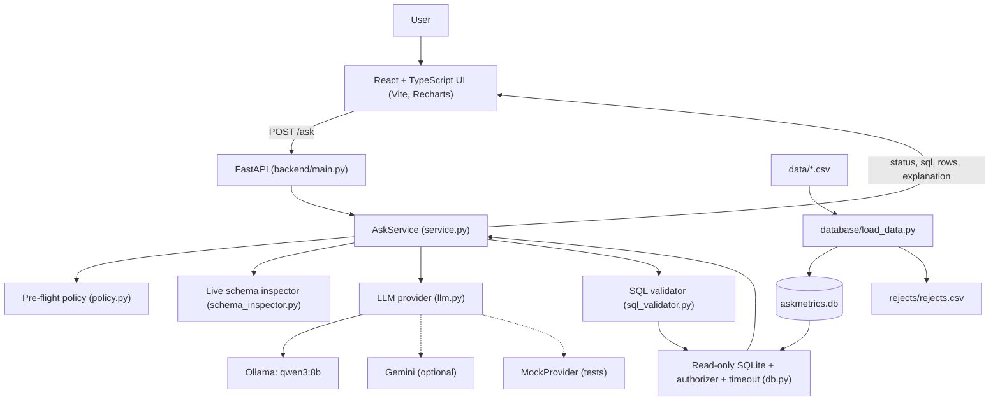

# AskMetrics

Ask business questions about a commerce database in plain English and get back the SQL, the result table and a chart, generated by a local LLM behind a layered read-only safety boundary.

## Overview

Non-technical teams often need simple numbers ("What is our revenue by month?", "Which payment method fails most often?") but cannot write SQL, and letting an LLM run SQL directly against a database is risky. AskMetrics is a text-to-SQL analytics assistant that:

- cleans three messy CSV exports (users, orders, payments) into a validated relational SQLite database,
- gives a local LLM (Ollama with `qwen3:8b` by default) the live database schema plus explicit business-metric definitions,
- treats the generated SQL as untrusted and passes it through several independent safety layers before running it read-only,
- shows the SQL, the rows and an automatically chosen visualization in a chat-style React UI.

The project was built for a technical assessment. The data forensics and metric decisions are documented in [`DECISIONS.md`](DECISIONS.md), [`METRICS.md`](METRICS.md) and [`EVALS.md`](EVALS.md), and AI-assisted development is recorded in [`AI_USAGE.md`](AI_USAGE.md).

## Key features

- **Natural-language to SQL** with a pluggable provider: Ollama (default, fully local), Google Gemini (optional, API key) or a deterministic mock provider for offline tests.
- **Live schema grounding**: tables, columns, keys and foreign keys are read from SQLite at request time (`sqlite_master` and `PRAGMA table_info`), never from a hard-coded list.
- **Business semantic hints**: the prompt carries explicit definitions for revenue, discounts, net spend, store credit, AOV and payment failure, so the model does not guess what "revenue" means.
- **Defense-in-depth read-only safety**: question pre-flight policy, SQL validator, read-only SQLite connection, SQLite authorizer callback, application-enforced row cap and query timeout.
- **Bounded self-repair**: if validation or execution fails, the model is asked once (configurable) to repair its SQL using the error message.
- **Clean refusals** for destructive requests, prompt injection, unsupported dimensions (for example "region") and vague questions.
- **Deterministic visualization**: the frontend picks KPI card, line chart, bar chart, grouped chart or table purely from the shape of the result.
- **Currency-aware presentation**: money is stored as integer cents; the UI formats INR and USD separately and never plots them on a shared axis.
- **Reproducible data pipeline** with normalization, reconstruction of missing values, rejection logging and verification scripts.

## Architecture



| Component | Responsibility |
|---|---|
| [`backend/main.py`](backend/main.py) | FastAPI app, CORS for the Vite dev server, `/`, `/health`, `/schema` and `/ask` endpoints. Questions are limited to 2,000 characters. |
| [`backend/service.py`](backend/service.py) | Orchestrates one request: policy, schema, generation, validation, execution, repair loop and response shaping. |
| [`backend/policy.py`](backend/policy.py) | Regex pre-flight that refuses destructive intent, prompt-injection phrases, revenue-by-region and overly vague questions before any LLM call. |
| [`backend/schema_inspector.py`](backend/schema_inspector.py) | Builds a text description of the live schema for the prompt. |
| [`backend/semantic_hints.py`](backend/semantic_hints.py) | Business metric definitions and example SQL injected into the system prompt. |
| [`backend/llm.py`](backend/llm.py) | System prompt and the `OllamaProvider`, `GeminiProvider` and `MockProvider`. Strips Qwen3 `<think>` blocks and extracts the `{"sql", "explanation"}` JSON. |
| [`backend/sql_validator.py`](backend/sql_validator.py) | Requires `SELECT`/`WITH`, removes comments and literals then rejects mutation keywords, uses `EXPLAIN QUERY PLAN` as a parse and single-statement check, and wraps the query in a `LIMIT` sub-select. |
| [`backend/db.py`](backend/db.py) | Opens SQLite with `mode=ro` and `PRAGMA query_only`, installs an authorizer that only allows read operations, and interrupts queries that exceed the time budget via a progress handler. |
| [`database/`](database/) | Schema, CSV loader and verification scripts. |
| [`frontend/`](frontend/) | Chat UI, API client, chart selection and currency formatting. |

## How it works

### Request lifecycle

1. The user types a question; the UI sends `POST /ask {"question": "..."}`.
2. **Pre-flight policy** normalizes the text and refuses obvious destructive or injection attempts and known unanswerable questions, returning `status: "refusal"` without calling the model.
3. A **read-only connection** is opened and the **live schema** is extracted.
4. The **LLM provider** receives the system prompt (rules, live schema, semantic hints) and the question, delimited as untrusted data. Ollama is called with `format="json"` and `temperature=0`.
5. An empty `sql` with a `REFUSE: ...` explanation becomes a refusal.
6. The **SQL validator** checks the statement and wraps it as `SELECT * FROM (<sql>) LIMIT <max_rows>`.
7. The query runs with the **authorizer** active and a **timeout** (default 1,500 ms).
8. On a validation error, SQLite error or timeout, the provider's `repair()` is called with the previous SQL and the error, up to `ASKMETRICS_RETRY_COUNT` times.
9. The response contains `status` (`success`, `refusal` or `error`), the generated `sql`, `rows`, `row_count`, `explanation` and `attempts`.
10. The UI shows the SQL and renders the rows using the deterministic chart rules below.

### Safety layers

```text
question
  -> pre-flight policy          (destructive intent, prompt injection, unsupported/vague questions)
  -> live schema + semantic hints
  -> LLM                        (output treated as untrusted)
  -> SQL validator              (SELECT/WITH only, forbidden keywords, single statement, parse check)
  -> read-only SQLite           (mode=ro, PRAGMA query_only = ON)
  -> SQLite authorizer          (only SELECT/READ/RECURSIVE; blocks most PRAGMAs and load_extension/readfile/writefile)
  -> LIMIT wrapper              (row cap enforced by the application, not the model)
  -> timeout                    (progress handler interrupts runaway scans and recursive CTEs)
  -> result
```

### Chart selection (frontend)

| Result shape | Rendering |
|---|---|
| 1 row, 1 numeric column | KPI card plus table |
| 1 text dimension and numeric metrics | Line chart if the dimension looks like time (`date`, `month`, `year`...), otherwise bar chart, plus table |
| 2 dimensions and 1 metric | Pivoted grouped chart plus table |
| Monetary metrics grouped only by `currency` | Table only (INR and USD are different units) |
| Anything else | Table |

Columns such as `*_cents`, `revenue_cents` or `SUM(...cents...)` are detected as monetary and formatted as `₹1,500.00` or `$1,500.00` depending on the row's `currency`; axis ticks use compact forms such as `$15k`.

### Data pipeline

[`database/load_data.py`](database/load_data.py) performs a transactional full refresh of `askmetrics.db` from [`data/`](data/):

- normalizes three date formats, mixed timestamp formats, tier casing, email whitespace and money strings (stored as integer cents);
- renames `orders.credit` to `discount_amount_cents`, because cross-table arithmetic shows it behaves as a discount;
- reconstructs 46 missing captured payment amounts from `gross - discount - wallet_applied`;
- rejects 23 orders with unknown users and 44 payments with missing parent orders, writing each with its reason to [`rejects/rejects.csv`](rejects/rejects.csv);
- enforces constraints in [`database/schema.sql`](database/schema.sql) (checks, composite foreign key on `order_id` + `currency`, indexes).

[`database/verify_data.py`](database/verify_data.py) then checks row counts and forensic expectations.

```text
users 1 ───< orders 1 ───< payments
```

## Tech stack

| Layer | Technologies |
|---|---|
| Frontend | React 19, TypeScript, Vite, Recharts, lucide-react, oxlint |
| Backend | Python 3.11+, FastAPI, Uvicorn, Pydantic 2, python-dotenv |
| LLM | Ollama (`qwen3:8b` default) via the `ollama` Python client; optional Gemini REST API; deterministic mock |
| Database | SQLite (read-only URI connection, authorizer, progress handler) |
| Testing and evaluation | pytest, custom evaluation script |

## Project structure

```text
AskMetrics/
├── backend/
│   ├── main.py              # FastAPI endpoints
│   ├── service.py           # request orchestration and repair loop
│   ├── llm.py               # prompt + Ollama / Gemini / Mock providers
│   ├── policy.py            # pre-flight refusal rules
│   ├── sql_validator.py     # SQL safety checks and LIMIT wrapper
│   ├── db.py                # read-only connection, authorizer, timeout
│   ├── schema_inspector.py  # live schema description
│   ├── semantic_hints.py    # business metric definitions for the prompt
│   ├── config.py            # settings from environment / .env
│   └── requirements.txt
├── database/
│   ├── schema.sql           # tables, constraints, indexes
│   ├── load_data.py         # CSV cleaning and transactional load
│   └── verify_data.py       # post-load verification
├── data/                    # raw CSV exports (users, orders, payments)
├── rejects/rejects.csv      # rejected rows with reasons
├── evals/eval.py            # 15 hand-verified metric queries
├── tests/                   # pytest: SQL safety and service behaviour
├── frontend/
│   ├── src/App.tsx          # chat UI
│   ├── src/api.ts           # /ask client and response types
│   ├── src/components/ChartRenderer.tsx  # deterministic chart selection
│   └── src/utils/formatters.ts           # cents-to-currency formatting
├── DECISIONS.md             # data and ingestion decisions
├── METRICS.md               # business metric contract
├── EVALS.md                 # evaluation questions and worked answers
└── AI_USAGE.md              # AI-assisted development record
```

## Getting started

### Prerequisites

- Python 3.11+
- Node.js 20+ and npm
- [Ollama](https://ollama.com/) running locally (only needed for the default provider)

### 1. Pull the model

```bash
ollama pull qwen3:8b
```

Ollama serves on `http://localhost:11434` by default.

### 2. Build the database

From the repository root:

```bash
python database/load_data.py
python database/verify_data.py
```

Expected accepted rows: 434 users, 2,100 orders, 2,761 payments.

### 3. Start the backend

```bash
python -m pip install -r backend/requirements.txt
cp .env.example .env        # optional, see variables below
uvicorn backend.main:app --reload
```

The API runs at `http://localhost:8000` (interactive docs at `/docs`).

### 4. Start the frontend

```bash
cd frontend
npm install
npm run dev
```

Open `http://localhost:5173`. To point the UI at another API, copy `frontend/.env.example` to `frontend/.env.local` and set `VITE_API_BASE_URL`.

### Environment variables

From [`.env.example`](.env.example) and [`backend/config.py`](backend/config.py). The root `.env` is loaded with `override=True`, so its values take precedence over shell variables.

| Variable | Default | Purpose |
|---|---|---|
| `ASKMETRICS_LLM_PROVIDER` | `ollama` | `ollama`, `gemini` or `mock` |
| `OLLAMA_HOST` | `http://localhost:11434` | Ollama server URL (`OLLAMA_URL` is also accepted) |
| `OLLAMA_MODEL` | `qwen3:8b` | Ollama model name |
| `ASKMETRICS_MAX_RESULT_ROWS` | `100` | Row cap applied by the LIMIT wrapper |
| `ASKMETRICS_QUERY_TIMEOUT_MS` | `1500` | Per-query execution budget |
| `ASKMETRICS_RETRY_COUNT` | `1` | Number of SQL repair attempts |
| `GEMINI_API_KEY` | none | Required only when the provider is `gemini` |
| `GEMINI_MODEL` | `gemini-2.5-flash` | Gemini model name |
| `VITE_API_BASE_URL` | `http://localhost:8000` | Frontend API base URL (`frontend/.env.local`) |

### Tests and evaluation

Both require the database built in step 2.

```bash
pytest -v                 # SQL safety + service tests (use MockProvider, no LLM needed)
python evals/eval.py      # 15 hand-verified metric queries; prints PASS/FAIL and a pass rate
cd frontend && npm run build   # type-check and production build
```

- [`tests/test_safety.py`](tests/test_safety.py): SELECT allowed with LIMIT, DELETE and multi-statement rejected, row cap enforced, read-only connection blocks writes, runaway recursive CTE interrupted by the timeout.
- [`tests/test_service.py`](tests/test_service.py): refusals for destructive, injection, region and vague questions; correct answers and currency grouping for active users, discounts and revenue.

## API

| Method | Path | Description |
|---|---|---|
| GET | `/` | Service info and endpoint list |
| GET | `/health` | `{"status": "ok"}` |
| GET | `/schema` | Live schema text supplied to the model |
| POST | `/ask` | Body `{"question": "..."}`; returns the answer envelope |

```bash
curl -X POST http://localhost:8000/ask \
  -H "Content-Type: application/json" \
  -d '{"question": "How many active users do we have?"}'
```

```json
{
  "status": "success",
  "question": "How many active users do we have?",
  "sql": "SELECT COUNT(*) AS active_users FROM users WHERE is_active = 1",
  "rows": [{ "active_users": 350 }],
  "row_count": 1,
  "explanation": "Counts users marked active.",
  "attempts": 1
}
```

A refusal looks like:

```json
{ "status": "refusal", "sql": null, "rows": [], "explanation": "I can't answer that from this data: the dataset contains country, not region.", "attempts": 0 }
```

(The example SQL and explanation above are the deterministic mock provider's output; with Ollama the SQL text will vary.)

## Evaluation baseline

[`EVALS.md`](EVALS.md) documents 15 questions with hand-worked expected answers, and [`evals/eval.py`](evals/eval.py) checks reference SQL for each against the loaded database. Examples of the documented answers:

| Question | Expected answer |
|---|---|
| How many active users do we have? | 350 |
| Valid orders in June 2026 | 308 |
| Total revenue (captured + wallet applied - refunds) | INR 1,631,002.82 and USD 10,992.05, reported separately |
| Payment method that fails most often | netbanking, 113 failed attempts |

This baseline validates the **data and metric layer**. It does not measure the LLM's SQL accuracy; see the limitations below.

## Limitations and roadmap

- **No end-to-end LLM accuracy evaluation yet.** The 15-question baseline runs fixed SQL; running the natural-language questions through `/ask` and scoring the results is the planned next step ([`EVALS.md`](EVALS.md), "Known limitations").
- The pre-flight policy is a narrow regex list; the main protection against unsafe SQL comes from the validator and the database-level read-only controls.
- Single-tenant local setup: no authentication, CORS limited to the Vite dev server, SQLite file database.
- Revenue and other metrics follow the documented definitions in [`METRICS.md`](METRICS.md); other business definitions would need new semantic hints.
- INR and USD are never combined because the dataset has no exchange rates.
- The UI shows the model's SQL before the application's `LIMIT` wrapper is applied.

## Author

Built by [Suriyaprakash](https://github.com/suriyaprakash-25)
